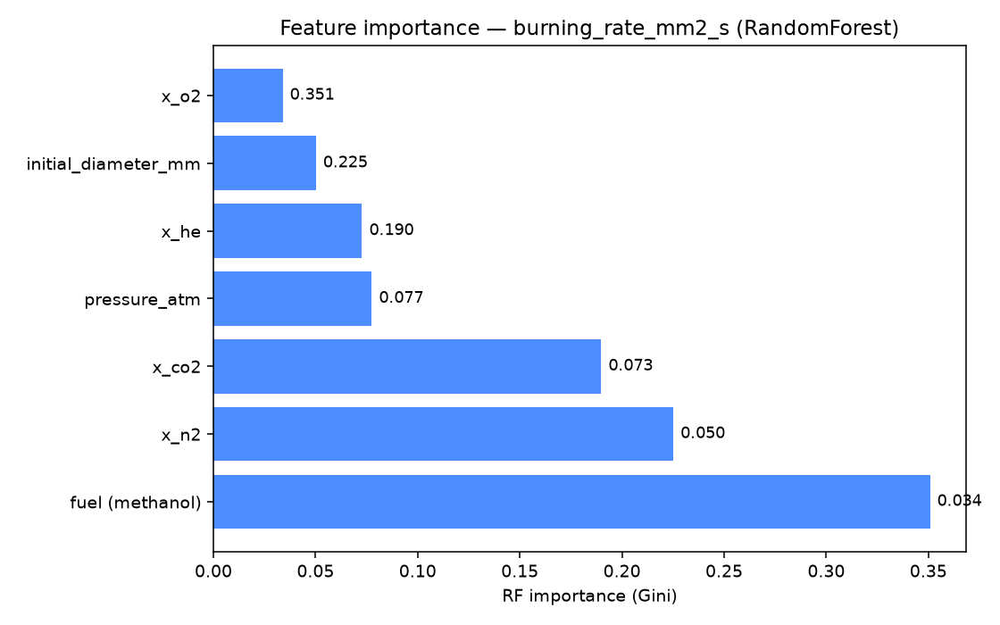
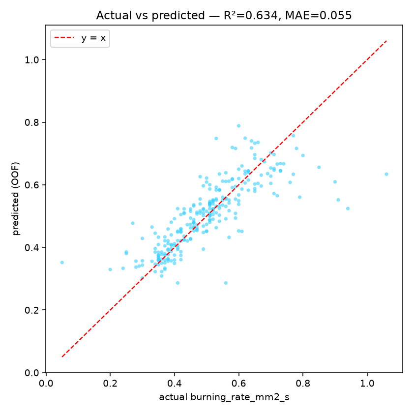
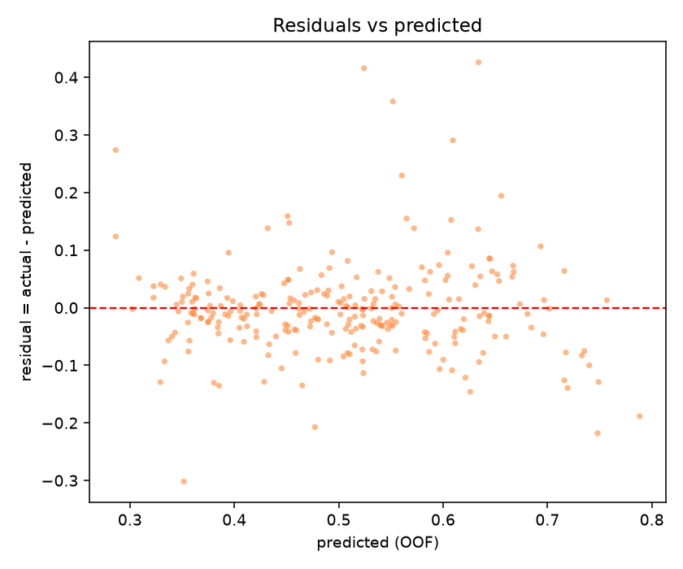

# Task 1 — Regression Report: `burning_rate_mm2_s`

## Setup

- **Target:** `burning_rate_mm2_s` (mm²/s)
- **Features:** `pressure_atm`, `x_o2`, `x_n2`, `x_co2`, `x_he`, `initial_diameter_mm`, `fuel_methanol`
- **Encoding:** `fuel` → binary `fuel_methanol` (Methanol=1, Heptane=0); numeric features median-imputed (fit per training fold).
- **Rows:** 258 used of 274 (dropped 16 with empty/zero target).
- **CV:** `GroupKFold(5)` on `campaign_id` (78 campaigns) — groups never split across folds (no leakage).
- **random_state:** 42 (models + bootstrap).
- **CI:** bootstrap on fold scores (B=10000, percentile, 90%).

## Results (out-of-fold)

| Model | MAE | RMSE | R² | MAE 90% CI (folds) | vs baseline |
|---|---:|---:|---:|---|---:|
| `baseline_fuel_mean` | 0.1026 | 0.1341 | 0.0470 | [0.0937, 0.1114] | +0.0% |
| `random_forest` | 0.0545 | 0.0831 | 0.6338 | [0.0492, 0.0601] | +46.8% |
| `hist_gradient_boosting` | 0.0564 | 0.0841 | 0.6254 | [0.0511, 0.0621] | +45.1% |

### Per-fold MAE

| Model | fold1 | fold2 | fold3 | fold4 | fold5 |
|---|---:|---:|---:|---:|---:|
| `baseline_fuel_mean` | 0.1086 | 0.1008 | 0.1004 | 0.0834 | 0.1198 |
| `random_forest` | 0.0511 | 0.0515 | 0.0676 | 0.0459 | 0.0565 |
| `hist_gradient_boosting` | 0.0504 | 0.0502 | 0.0696 | 0.0522 | 0.0596 |

## Selected model

**`random_forest`** — random_forest has the lowest OOF MAE (0.0545); no simpler model is within 5% of it.

Saved to `models/best_regressor.pkl` (refit on all 258 kept rows).

## Notes & caveats

- Baseline = training mean of `burning_rate_mm2_s` per fuel class (no other features used) — the reference the ML models must beat.
- Metrics on out-of-fold predictions; the 90% CI is a bootstrap over the 5 fold scores, so it is intentionally coarse.
- Prediction is only valid **inside the observed range** (O₂ ≈ 0.12–0.34, pressure ≈ 0.5–3.1 atm, d₀ ≈ 1.1–4.67 mm). **No extrapolation.**
- No deep learning used, per project rules.

## Feature Importance (RandomForest)

| Rank | Feature | Gini importance | Permutation (ΔMAE, fold-avg) |
|---:|---|---:|---:|
| 1 | `x_o2` | 0.351 | +0.0507 |
| 2 | `initial_diameter_mm` | 0.225 | +0.0159 |
| 3 | `x_he` | 0.190 | +0.0209 |
| 4 | `pressure_atm` | 0.077 | +0.0027 |
| 5 | `x_co2` | 0.073 | +0.0071 |
| 6 | `x_n2` | 0.050 | +0.0028 |
| 7 | `fuel (methanol)` | 0.034 | +0.0029 |

**Interpretation (top 3):**
1. `x_o2` — oxygen mole fraction controls oxidizer availability and flame temperature — a primary driver of burning rate.
2. `initial_diameter_mm` — droplet size sets the burning-rate envelope (d²-law and radiative/conductive losses scale with diameter).
3. `x_he` — He changes mixture transport properties and heat loss (light, high-conductivity diluent).

All three are direct physical controls of droplet burning: the top drivers are the oxidizer/diluent composition and the droplet size, consistent with d²-law combustion where ambient composition and initial diameter set the burning-rate envelope.

## Residual Analysis

- Mean residual (actual − predicted): **-0.0027** (≈0 → low overall bias).
- Residual std: **0.0831**; corr(predicted, residual) = **-0.009**.
- Mean residual by fuel: Methanol -0.0111, Heptane +0.0090.
- |error| ≤ 0.05 in **62.4%** of tests; ≤ 0.10 in **86.4%**.

The residuals scatter randomly around 0 with no strong trend versus the predicted value (|corr| < 0.2), so there is **no pronounced systematic bias**.

